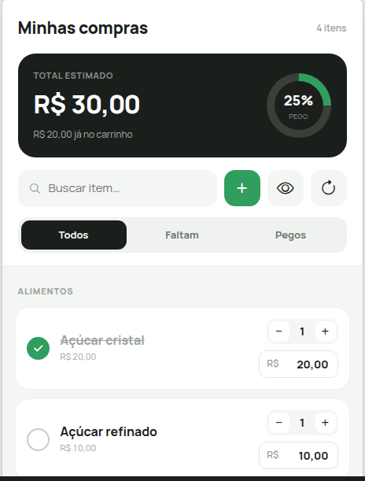

<h1 align="center">🛒 Lista de Compras</h1>

<p align="center">
  Um app de lista de compras feito em React — adicione produtos, controle quantidades e preços,
  acompanhe o total estimado e o quanto você já colocou no carrinho.
</p>

<p align="center">
  
  
  
  
  
  
</p>

<p align="center">
  <a href="https://lista-compras-psi.vercel.app/"><b>🔗 Acessar</b></a>
</p>

---

## 📸 Preview

<p align="center">
  
</p>

---

## ✨ Funcionalidades

**Lista**

- 🗂️ **Categorias** — Alimentos e Limpeza, com opção de renomear.
- ➕➖ **Quantidade e preço por item** — preço digitado em centavos (`0,01` → `0,13` → `1,35`) com total por linha.
- ✅ **Marcar como "pego"** — risca o item e alimenta o anel de progresso.
- 🔎 **Busca** sem acentos, **filtro** Todos / Faltam / Pegos e **ocultar zerados**.
- 📝 **Incluir, editar e excluir** qualquer produto (inclusive os padrão), com aviso de nome duplicado.
- ✔️ **Finalizar compra** — os itens pegos saem da lista e o que faltou continua para a próxima ida.
- ↩️ **Desfazer** exclusões, resets e compras finalizadas.

**Dinheiro**

- 💾 **Memória do último preço** — depois de um reset ou de finalizar a compra, o último preço pago fica como sugestão e entra no total estimado.
- 🧮 **Calculadora "qual compensa mais?"** — compara de 2 a 4 embalagens pelo preço por kg, L ou unidade, inclusive fardos (ex.: 6 × 350 ml), e aplica o preço vencedor direto no item da lista.

**Modo viagem** 🧳

- 🔀 **Botão no topo** alterna entre **Compras** e **Viagem**; cada modo tem a própria lista e o app lembra o último usado.
- 👨‍👩‍👧 **Grupos por pessoa** (Victor, Erica, Helena, Anderson) + **Geral** para o que é da família (documentos, carregador portátil, remédios…).
- ➕ **Incluir, renomear e remover pessoas** — quem entra já ganha a lista sugerida.
- 📋 **Lista sugerida** com os itens mais comuns de viagem (roupas, calçados, higiene, eletrônicos), incluindo os mais esquecidos: escova/pasta de dente e carregador.
- Sem preço: só quantidade e o check **"na mala"**.

**Uso no mercado e na viagem**

- 📲 **PWA offline** — instalável e funciona sem internet depois da primeira visita.
- 🔆 **Manter a tela ligada** enquanto a lista está aberta (Screen Wake Lock).
- 💬 **Compartilhar** a lista pelo WhatsApp ou copiar como texto.
- 📱 **Responsivo** — mobile-first, de 320px ao desktop.

---

## 🛠️ Tecnologias

- [React 18](https://react.dev/) + [Vite](https://vite.dev/)
- CSS puro com variáveis de cor (design tokens)
- [Bootstrap Icons](https://icons.getbootstrap.com/) (empacotados localmente, para funcionar offline)
- [React Toastify](https://fkhadra.github.io/react-toastify/) — notificações com "Desfazer"
- `localStorage` para persistência, com migração automática dos dados da versão anterior
- Service worker próprio (`public/sw.js`)
- [Vitest](https://vitest.dev/) + Testing Library, ESLint + Prettier

---

## 🚀 Como rodar localmente

Pré-requisitos: **Node.js** e **Yarn** (ou npm) instalados.

```bash
# clone o repositório
git clone https://github.com/VictorLoures/listaCompras.git
cd listaCompras

# instale as dependências
yarn install

# rode em modo desenvolvimento
yarn start
```

O app abre em [http://localhost:5173](http://localhost:5173).

---

## 📜 Scripts disponíveis

| Comando         | Descrição                                        |
| --------------- | ------------------------------------------------ |
| `yarn start`    | Roda o app em modo desenvolvimento (Vite)        |
| `yarn build`    | Gera a build de produção em `build/`             |
| `yarn preview`  | Serve a build de produção (com o service worker) |
| `yarn test`     | Executa os testes (Vitest, modo watch)           |
| `yarn lint`     | Verifica o código com ESLint                     |
| `yarn lint:fix` | Corrige problemas de lint automaticamente        |
| `yarn format`   | Formata o código com Prettier                    |

---

## 📁 Estrutura do projeto

```
listaCompras/
├── index.html                  # HTML base (Vite)
├── public/
│   ├── manifest.json           # Manifesto do PWA
│   └── sw.js                   # Service worker (offline)
├── src/
│   ├── main.jsx                # Entrada: monta o App e registra o service worker
│   ├── App.jsx                 # Layout e orquestração dos modais
│   ├── App.css                 # Estilos e tokens de cor
│   ├── components/             # Item, total, modais, calculadora, menu…
│   ├── hooks/
│   │   ├── useListaCompras.js  # Estado + persistência + desfazer
│   │   └── useTelaLigada.js    # Screen Wake Lock
│   ├── state/lista.js          # Reducer puro com as regras de negócio
│   └── utils/                  # Dinheiro (centavos), persistência/migração,
│                               # calculadora, compartilhar, produtos iniciais
└── package.json
```

---

## 🧠 Como funciona

- A lista de compras fica em `listaCompras:v2` e a de viagem em `listaViagem:v1` no `localStorage`;
  o modo atual fica em `listaCompras:modo`. Na primeira abertura, os dados da versão antiga são migrados automaticamente.
- Preços são guardados como **inteiros em centavos**, sem erro de arredondamento.
- As regras (reset, finalizar compra, categorias…) ficam em um reducer puro em `src/state/lista.js`,
  testado isoladamente.
- **Reset**: zera quantidades, preços e marcações; mantém só os produtos marcados como
  "manter na lista" e guarda o último preço pago como sugestão.
- **Finalizar compra**: os itens pegos saem da lista (o preço pago vira sugestão); o que faltou
  continua para a próxima compra.

---

## 👤 Autor

Feito por **Victor Loures**.
